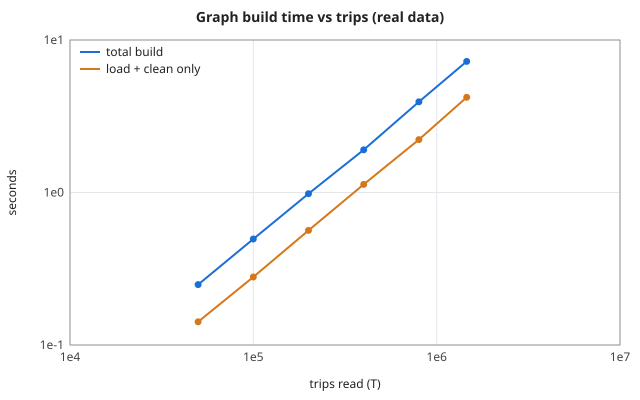
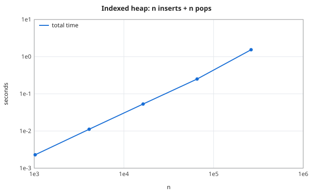
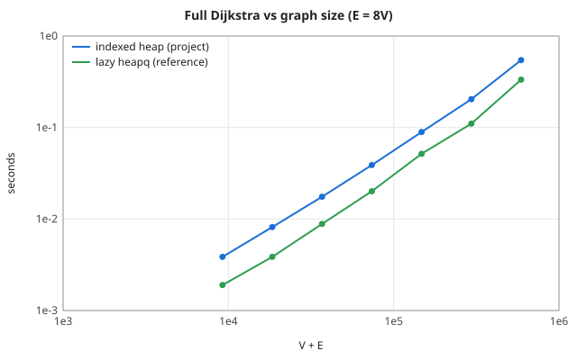
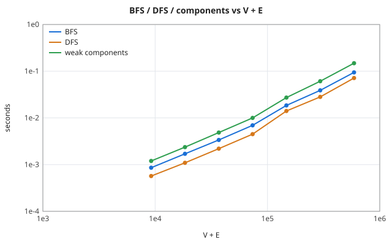

# SP4: Analysis (Algorithm Complexity)

Algorithmic Estimation of NYC Taxi Trip Duration. CS501, Fall 2026, Team 5.

This document analyzes the time and space complexity of every algorithm in the implementation. For each one it gives the theoretical bound with a short derivation, then compares it with measurements: exact operation counts and running times. It follows the "Expected Complexity" table of the proposal and section 9 of the SP3 architecture.

Reproduce everything with:

```bash
python3 -m taxi_graph complexity --csv data/NYC.csv --out-dir docs/sp4   # a few minutes
```

Raw numbers: [sp4/results.json](sp4/results.json). Plots: `docs/sp4/*.svg`.

## 1. Notation and the real graph

| Symbol | Meaning | Real data (Kaggle NYC taxi, default 0.005 degree grid) |
|---|---|---|
| T | trips read from the CSV | 1,458,644 (1,455,814 kept after cleaning) |
| V | graph vertices (grid cells with trips) | 4,001 |
| E | directed edges (cell pairs with trips) | 117,785 (average out-degree 29.4) |
| D | decrease-key operations in one Dijkstra run | measured in section 5.4 |
| deg(u) | out-degree of vertex u | |

Since each edge needs at least one trip, E <= T. The real graph is small (V = 4,001), so constant factors matter more than asymptotics for the real queries; the controlled experiments below use larger synthetic graphs to test the asymptotic claims.

## 2. Theoretical analysis

### 2.1 Time and space per component

| Component | Time | Extra space | Why |
|---|---|---|---|
| Load and clean (streaming) | O(T) | O(1) | A fixed number of fields and comparisons per row; rows are yielded one at a time. |
| Grid key (coordinate to cell) | O(1) | O(1) | Two subtractions, two divisions, one multiply-add. |
| Hash index (`get_or_add`, `lookup`) | O(1) expected | O(V) | Python `dict`; worst case O(V) per operation only under adversarial hash collisions. |
| Edge aggregation (mean) | O(T) expected | O(E) | One dict update per trip, keyed by one packed int `(u << 32) \| v`. The median option stores durations: O(T) space and O(sum k log k) <= O(T log T) time. |
| CSR graph build | O(V + E) | O(V + E) | Counting sort by source: count degrees, prefix sums, one placement pass. |
| **Whole build** | **O(T + V + E) = O(T)** | O(V + E) | E <= T. |
| Reverse adjacency (cached) | O(V + E) | O(V + E) | Same counting sort on targets. |
| BFS | O(V + E) | O(V) | Each vertex enqueued once, each edge examined once. |
| DFS (iterative stack) | O(V + E) | O(V) | Each vertex pushed once, each edge examined once. |
| Weak components (DFS, forward + reverse) | O(V + E) | O(V + E) | Each vertex and each edge in both directions visited once. |
| Indexed heap push / decrease-key / pop | O(log n) | O(n) | Sift up or down along one root-to-leaf path of a binary heap of n entries. |
| Heap `clear()` | O(size) | | Resets only the positions of entries still in the heap. |
| **Dijkstra (indexed heap)** | **O((V + E) log V)**; refined: O(E + (V + D) log V) | O(V) workspace | See 2.2. |
| Dijkstra, one query with early stop | O(E_s + (V_s + D_s) log V_s) over the touched part only | O(1) extra | The workspace is reset in O(touched), not O(V). |
| Multi-target `distances()` | One search per distinct source | O(V) | Used by validation: one search answers all test trips with that origin. |
| Direct-edge lookup (`edge_weight`) | O(deg(u)) | O(1) | Linear scan of one CSR row. Average degree is 29. |
| Kruskal MST | O(E log E) = O(E log V) | O(V + E) | Sort E edges, then at most E union-find operations at O(alpha(V)) each. |
| Validation (`validate`, `tune`) | O(T) + O(S (V + E) log V) | O(V + E) | S = distinct test origins, S <= V. |

### 2.2 Dijkstra derivation

Each vertex is inserted into the heap at most once (it is then updated by decrease-key, never re-inserted) and popped at most once, so the heap never holds more than V entries and every heap operation costs O(log V), not O(log E).

- V inserts and V pops: O(V log V).
- Every edge is scanned once when its tail is popped: O(E). The scan itself is O(1) per edge; only an edge that improves a distance triggers a heap operation.
- D = number of improving relaxations that hit a vertex already in the heap, each O(log V). Worst case D <= E - V + 1.

Total O(E + (V + D) log V), at most O((V + E) log V), the bound in the proposal. The refinement matters: when D is much smaller than E, the E term costs O(1) per edge instead of O(log V). Section 5.4 and 5.5 measure D.

A lazy-deletion heap (the standard `heapq` pattern, pushing a new entry per improvement) does V + D pushes and holds up to V + D entries, so its bound is O((V + D) log(V + D)) <= O(E log V) with O(E) space. The two variants have the same asymptotic time; they differ in constants and heap memory (section 5.6).

### 2.3 What the theory does not say

Big-O hides constant factors and memory-hierarchy effects. The experiments therefore check three things separately: exact operation counts (which must match the theory exactly), the fitted growth exponent of running time, and absolute constants.

## 3. Method

Experiments (all in `taxi_graph/complexity.py`):

| # | Experiment | Data | What varies |
|---|---|---|---|
| E1 | Build pipeline, split into load/clean and aggregate/graph | real | T = 50k to 1.46M rows |
| E2 | Hash lookup microbenchmark | synthetic dict | V = 10^3 to 10^6 |
| E3 | Indexed heap, n inserts then n pops | random keys | n = 2^10 to 2^18 |
| E4 | Full Dijkstra, indexed and lazy `heapq` reference | random digraphs, E = 8V | V = 2^10 to 2^16 |
| E5 | Full Dijkstra, density sweep | random digraphs, V = 16,384 | E = 2V to 64V |
| E6 | BFS, DFS, weak components | random digraphs, E = 8V | V = 2^10 to 2^16 |
| E7 | Kruskal, with sort time separated | random digraphs, V = 20,000 | average degree 2 to 32 |
| E8 | CSR memory | random digraphs, E = 8V | V = 2^10 to 2^16 |
| E9 | Early stopping on the real graph | real | 400 reachable random pairs |

Design choices:

- **Controlled graphs.** Random digraphs are strongly connected (a ring plus random edges, weights uniform in [1, 100]), so every search touches the whole graph and V and E can be varied independently. The real graph cannot do that.
- **Operation counts.** A counting subclass of the heap records inserts, decrease-keys and pops; the search records vertices settled and edges relaxed. These are exact, not timed.
- **Growth exponent.** For each timing series we fit the slope of log(time) against log(size). Slope 1 is linear. Over the ranges used here, `n log n` has a local slope of 1 + 1/ln(n), about 1.08 to 1.11, so linear and `n log n` are close and a fitted slope between 1.0 and about 1.2 does not by itself separate them. That is why the exact operation counts matter more than slopes.
- **Timing.** `time.perf_counter`, best of 2 or 3 repeats per point, one run on one machine (Apple M1, 16 GB, macOS, Python 3.12.3), no CPU pinning. The whole suite was run twice; fitted slopes agreed to within about 0.03 and build time per trip was 4.96 to 4.98 microseconds both times.
- **Same-input comparisons.** The real-data query experiment compares early-stop and full searches from the same source, and the project Dijkstra against the lazy reference on the same pairs (the assertions check both return the same distance).

## 4. Summary of findings

| Claim (proposal / SP3) | Operation counts | Fitted time exponent | Verdict |
|---|---|---|---|
| Build is O(T) | n/a | 0.997 | Confirmed |
| Hash lookup is O(1) average | n/a | flat to V = 10^4, then rises (section 5.2) | O(1) operations; wall time grows once the table outgrows cache |
| BFS and DFS are O(V + E) | edges examined = E exactly | 1.14 (BFS), 1.18 (DFS) | Confirmed in operations; time about 15% above linear |
| Dijkstra is O((V + E) log V) | settled = V, relaxed = E, inserts = V, pops = V, D = 0.78 V | 1.18 | Confirmed, and loosely: D is about 10% of E |
| Kruskal is O(E log E) | n/a | 1.17 (sort alone: 1.31) | Confirmed; the sort is 35 to 51% of the time |
| Space is O(V + E) | n/a | 1.001 | Confirmed |

Three results go beyond confirming the proposal:

1. **The E term in Dijkstra is cheaper than the bound suggests.** With E multiplied by 32 at fixed V, time grew only 5.1 times. The refined bound O(E + (V + D) log V) explains this (5.5).
2. **A lazy `heapq` Dijkstra does the same heap work and runs faster in Python.** Its push count equals V + D exactly, and it is 1.6 to 2.1 times faster on full searches because `heapq` is C code (5.6). The indexed heap is kept because the architecture specifies it and it bounds heap size, not because it is faster here.
3. **Early stopping saves less than expected on the real graph:** about 24% of the time (5.7).

## 5. Results

### 5.1 Build is linear in the number of trips

| T read | V | E | Load + clean (s) | Whole build (s) | Aggregate + graph (s) | Microseconds per trip |
|---|---|---|---|---|---|---|
| 50,000 | 1,378 | 19,997 | 0.142 | 0.249 | 0.107 | 4.98 |
| 100,000 | 1,817 | 29,524 | 0.279 | 0.496 | 0.216 | 4.96 |
| 200,000 | 2,303 | 43,049 | 0.564 | 0.982 | 0.418 | 4.91 |
| 400,000 | 2,807 | 61,849 | 1.130 | 1.906 | 0.775 | 4.76 |
| 800,000 | 3,395 | 87,812 | 2.223 | 3.935 | 1.712 | 4.92 |
| 1,458,644 | 4,001 | 117,785 | 4.212 | 7.240 | 3.028 | 4.96 |



Fitted exponent 0.997 (load + clean alone: 1.003). Microseconds per trip are flat at about 4.9 across a 29-fold range, as O(T) predicts. Load and clean is 58% of the time; aggregation and CSR construction is 42%. V and E grow far more slowly than T (4,001 vertices from 1.46 million trips), so the O(V + E) part of the build is negligible.

### 5.2 Hash lookups: O(1) operations, but not flat wall time

| V | ns per lookup |
|---|---|
| 1,000 | 63.9 |
| 10,000 | 67.3 |
| 100,000 | 105.4 |
| 1,000,000 | 466.2 |

Each lookup is one hash and one probe regardless of V, which is what O(1) expected means. The wall time is flat up to V = 10^4 and then rises sevenfold by V = 10^6. This is consistent with the table outgrowing the CPU cache, but we did not measure cache misses directly, so that explanation is a hypothesis. For the real graph (V = 4,001) the index sits in the flat region at about 64 ns.

### 5.3 Heap operations: O(log n)

| n | Total for n inserts + n pops (s) | Microseconds per operation per log2(n) |
|---|---|---|
| 1,024 | 0.0023 | 0.112 |
| 4,096 | 0.0112 | 0.114 |
| 16,384 | 0.0532 | 0.116 |
| 65,536 | 0.2507 | 0.120 |
| 262,144 | 1.539 | 0.163 |



If each operation costs c log2(n), the last column is constant. It is within 7% from n = 1,024 to 65,536, then rises 36% at n = 262,144, again where the arrays no longer fit in cache. Dijkstra on the real graph uses heaps of at most 4,001 entries, well inside the flat region.

### 5.4 Dijkstra: exact operation counts, and the size sweep

Full single-source runs on strongly connected random graphs with E = 8V. The first four count columns are identical across all sizes and match the theory exactly:

| V | E | Settled | Relaxed | Heap inserts | Heap pops | Decrease-keys D | D / V | Time (s) | Time / ((V+E) log2 V), microseconds |
|---|---|---|---|---|---|---|---|---|---|
| 1,024 | 8,192 | 1,024 | 8,192 | 1,024 | 1,024 | 830 | 0.81 | 0.00386 | 0.0418 |
| 2,048 | 16,384 | 2,048 | 16,384 | 2,048 | 2,048 | 1,607 | 0.78 | 0.00816 | 0.0403 |
| 4,096 | 32,768 | 4,096 | 32,768 | 4,096 | 4,096 | 3,170 | 0.77 | 0.01751 | 0.0396 |
| 8,192 | 65,536 | 8,192 | 65,536 | 8,192 | 8,192 | 6,430 | 0.78 | 0.03885 | 0.0405 |
| 16,384 | 131,072 | 16,384 | 131,072 | 16,384 | 16,384 | 12,804 | 0.78 | 0.08921 | 0.0432 |
| 32,768 | 262,144 | 32,768 | 262,144 | 32,768 | 32,768 | 25,755 | 0.79 | 0.2039 | 0.0461 |
| 65,536 | 524,288 | 65,536 | 524,288 | 65,536 | 65,536 | 51,406 | 0.78 | 0.5447 | 0.0577 |

- Every vertex is settled once, every edge is relaxed once, and the heap sees V inserts and V pops. This is the theory, exactly.
- D is about 0.78 V, which is about 10% of E here and far below the worst case E - V + 1. With uniformly random weights, most vertices are reached early by a short edge and improved only a few times.
- Time fits an exponent of 1.18 against V + E. The pure `(V + E) log V` shape would give about 1.09, so the measured growth is somewhat faster; the normalized column rises 38% over a 64-fold size increase, which is the same memory-hierarchy pattern as 5.2 and 5.3.



### 5.5 Dijkstra: the E term is cheaper than log V per edge

V fixed at 16,384; E increased 32-fold by raising the average out-degree from 2 to 64:

| E | Average degree | Time (s) | Decrease-keys D | D / E |
|---|---|---|---|---|
| 32,768 | 2 | 0.0535 | 1,111 | 3.4% |
| 65,536 | 4 | 0.0684 | 5,305 | 8.1% |
| 131,072 | 8 | 0.0950 | 12,804 | 9.8% |
| 262,144 | 16 | 0.1257 | 22,128 | 8.4% |
| 524,288 | 32 | 0.1744 | 31,861 | 6.1% |
| 1,048,576 | 64 | 0.2701 | 41,319 | 3.9% |

Time rises only 5.1 times for a 32-fold increase in E (fitted exponent 0.46). A bound of the form `E log V` would predict a roughly 32-fold increase. The data are close to affine in E: a fixed cost of about 47 ms (the V log V heap work) plus about 0.21 microseconds per edge scanned. D stays below 10% of E at every density. This matches the refined bound O(E + (V + D) log V) from 2.2: scanning an edge is O(1), and only the few improving relaxations pay O(log V).

This is a property of these inputs. Random uniform weights keep D small; an adversarial graph can force D toward E - V + 1, and then the full O(E log V) is reached.

### 5.6 Indexed heap versus a lazy `heapq` heap

On the same random graphs (full searches, E = 8V):

| V | Indexed heap (s) | Lazy heapq (s) | Indexed / lazy | Lazy pushes | V + D |
|---|---|---|---|---|---|
| 1,024 | 0.00386 | 0.00190 | 2.03 | 1,854 | 1,854 |
| 4,096 | 0.01751 | 0.00883 | 1.98 | 7,266 | 7,266 |
| 16,384 | 0.08921 | 0.05163 | 1.73 | 29,188 | 29,188 |
| 65,536 | 0.5447 | 0.3334 | 1.63 | 116,942 | 116,942 |

- The lazy heap's push count equals V + D exactly (the two right columns are identical), so the two variants do the same number of heap insertions; the lazy one just stores some of them as stale duplicates.
- The lazy version is 1.6 to 2.1 times faster. `heapq` is implemented in C, while the indexed heap is pure Python, and the extra bookkeeping (position array, decrease-key) costs more than it saves. The ratio shrinks as graphs grow (2.03 to 1.63), but we did not test whether it keeps shrinking.
- On the real graph, for the same reachable pairs with early stop, the lazy version takes 88.5% of the indexed version's time (5.7).
- The asymptotic gap is nil in these runs: both fit an exponent near 1.2 (1.18 indexed, 1.24 lazy).

The indexed heap is kept for design reasons: SP3 specifies it, it bounds the heap at V entries (the lazy heap holds up to V + D, here about 1.8 V), and it implements decrease-key, a CS501 topic. It is not the faster choice in CPython, and this report does not claim it is.

### 5.7 Early stopping on the real graph

400 random source-destination pairs that have a path. For each, the same source is also searched without early stop, and the lazy reference runs with early stop; every result was checked to give the same distance.

| Measure | Value |
|---|---|
| Random pairs tried to get 400 reachable pairs | 1,151 (65.2% unreachable) |
| Vertices settled with early stop (mean / median / 90th percentile) | 1,789 / 1,736 / 3,366 of 4,001 |
| Vertices settled by a full search from the same source (mean) | 3,696 |
| Early stop as a share of full search: vertices (mean of per-pair ratios) | 48.4% |
| Early stop as a share of full search: edges relaxed | 85.8% |
| Early stop as a share of full search: time | 76.0% |
| Time per query, indexed heap with early stop (mean / 90th percentile) | 19.9 ms / 25.6 ms |
| Time per query, full indexed search | 26.2 ms |
| Lazy heapq with early stop, as a share of the indexed time | 88.5% |

Early stopping halves the vertices settled but saves only 24% of the time and 14% of the edge work. We did not isolate the cause. Plausible factors: the graph is small and dense (average degree 29), so a search scans many edges before the destination is settled, and the vertices it settles first may have above-average degree. The benefit should be larger on bigger graphs or for nearby destinations, but we did not test that.

Pairs without a path are different: the search settles the source's entire reachable set and then fails. 65% of random pairs are in this case, which is why averaging over random pairs (about 5 ms in `bench`) understates the cost of a query that has an answer (about 20 ms). Earlier project notes quoted only the blended figure; they have been corrected.

### 5.8 BFS, DFS and weak components

Strongly connected random graphs, E = 8V; the searches start at vertex 0 and reach every vertex.

| V | E | BFS (s) | DFS (s) | Weak components (s) |
|---|---|---|---|---|
| 1,024 | 8,192 | 0.00086 | 0.00057 | 0.00120 |
| 4,096 | 32,768 | 0.00337 | 0.00219 | 0.00485 |
| 16,384 | 131,072 | 0.01853 | 0.01407 | 0.02725 |
| 65,536 | 524,288 | 0.09423 | 0.07134 | 0.14840 |



- Edges examined by BFS equal E exactly at every size, as O(V + E) predicts.
- Time exponents are 1.14 (BFS), 1.18 (DFS) and 1.17 (components), above the theoretical 1.0. Per unit of V + E, BFS goes from 93 ns to 160 ns across the range: again a memory-hierarchy effect on random adjacency access, not extra operations.
- DFS runs at 65 to 76% of BFS time; BFS also builds a level array, which is a plausible reason (not isolated). Components cost 1.4 to 1.6 times BFS because they scan both forward and reverse adjacency. The reverse adjacency is built once and cached, so the best-of-N timing excludes its one-time O(V + E) construction.

### 5.9 Kruskal MST

V = 20,000, average degree 2 to 32 (E is the number of distinct undirected edges):

| E (undirected) | Sort alone (s) | Whole Kruskal (s) | Sort share |
|---|---|---|---|
| 40,000 | 0.0191 | 0.0547 | 35% |
| 79,996 | 0.0474 | 0.1188 | 40% |
| 159,963 | 0.1301 | 0.2836 | 46% |
| 319,867 | 0.3063 | 0.6411 | 48% |
| 639,480 | 0.6911 | 1.355 | 51% |

Whole-run exponent 1.17; sort alone 1.31. Sort time per `E log2 E` rises from 31 ns to 56 ns, so the sort grows faster than `E log E` here (sorting tuples through a key function, with poorer cache behavior as the list grows). The rest of Kruskal (building the undirected edge map, union-find with path halving and union by rank) grows close to linearly. On the real graph the MST has 3,805 edges (V minus 196 components) and matches an independent Prim implementation.

### 5.10 Space

| V | E | CSR bytes | Bytes per edge | Bytes per (V + E) |
|---|---|---|---|---|
| 1,024 | 8,192 | 236,728 | 28.9 | 25.7 |
| 4,096 | 32,768 | 949,432 | 29.0 | 25.8 |
| 16,384 | 131,072 | 3,800,280 | 29.0 | 25.8 |
| 65,536 | 524,288 | 15,203,608 | 29.0 | 25.8 |

Exponent 1.0008: the graph structure is linear in V + E, with a constant of about 29 bytes per edge. Caveat: `tracemalloc` here counts only allocations made inside `from_edges`; the float weights and integer ids built earlier (a CPython float is 24 bytes, an int above 256 is 28) are not counted, so the real footprint is larger than this figure by a constant per edge. Other space costs follow the table in 2.1: the Dijkstra workspace is O(V), and the aggregation dict is O(E) during the build. A full-pipeline run on the real data peaks at about 39 MB (`bench --memory`).

## 6. Limitations

- One machine (Apple M1, 16 GB, Python 3.12.3), no CPU pinning, best of 2 or 3 repeats. Absolute times will differ elsewhere; exponents and operation counts should not.
- Fitted exponents come from about 1.8 decades of size, so they cannot separate `n log n` from `n^1.1`. The exact operation counts are the stronger evidence; the exponents are a consistency check.
- Several time exponents exceed theory by 0.05 to 0.15. The explanation offered (cache effects) is consistent with the hash and heap microbenchmarks but was not measured directly.
- The random graphs have uniform weights and a ring backbone. They show typical behavior, not worst cases; the Dijkstra decrease-key count D in particular depends on the weight distribution.
- The asymptotic experiments stop at V = 65,536 and E about 1 million. The real graph has V = 4,001, where constants dominate.
- The real-data query timings use 400 pairs from one random seed; the 24% saving from early stop and the 88.5% lazy-versus-indexed ratio carry sampling noise that we did not quantify.
- Space was measured for the CSR structure only (5.10), not for the full pipeline across sizes.

## 7. Conclusions

1. Every operation count matches theory exactly: BFS examines E edges, Dijkstra settles V vertices, relaxes E edges and performs V inserts and V pops.
2. The build is linear in the number of trips (exponent 0.997, about 4.96 microseconds per trip), and graph storage is linear in V + E (exponent 1.001).
3. Dijkstra's practical cost is closer to O(E + (V + D) log V) than to O((V + E) log V): with D about 10% of E, adding edges is cheap. The stated bound still holds.
4. Wall-clock exponents run 0.05 to 0.15 above theory for the memory-bound structures (hash table, heap, adjacency scans). This is a constant-factor and hardware effect, not an algorithmic one.
5. In CPython a lazy `heapq` Dijkstra does the same heap work (V + D pushes) and runs 1.6 to 2.1 times faster than the indexed heap. The indexed heap's benefit is a bounded heap size and a true decrease-key, which the architecture requires, not speed.
6. On the real graph, early stopping halves the vertices settled but saves about a quarter of the time, and 65% of random pairs have no path at all, so query cost must be reported separately for reachable pairs.
